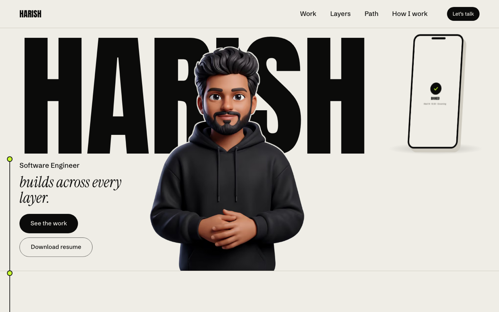
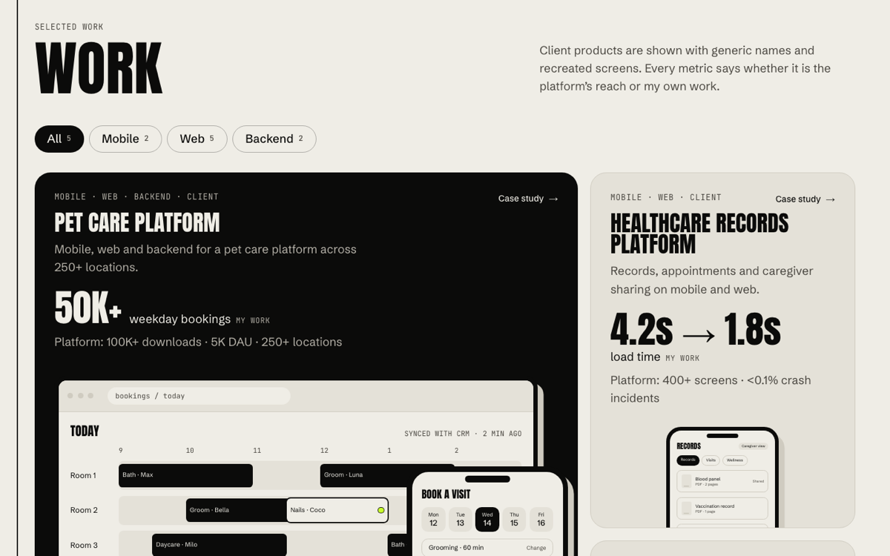
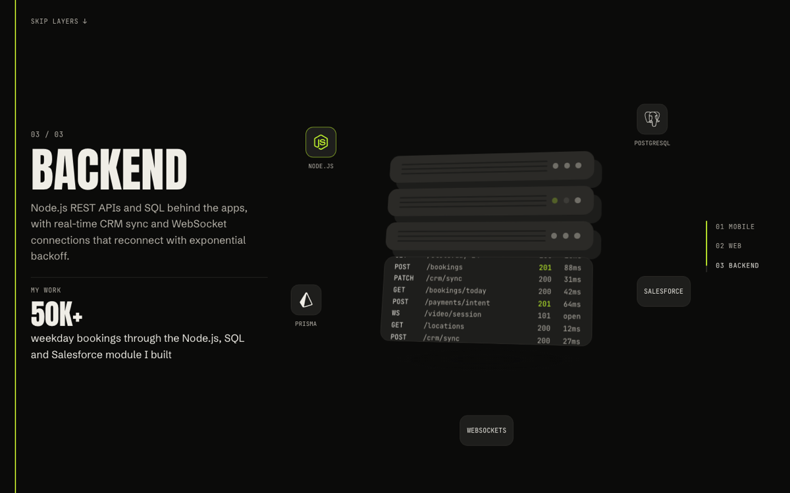
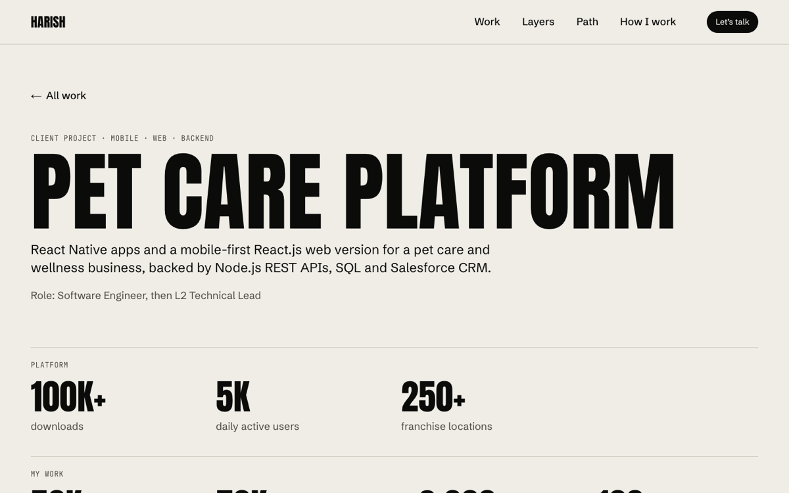
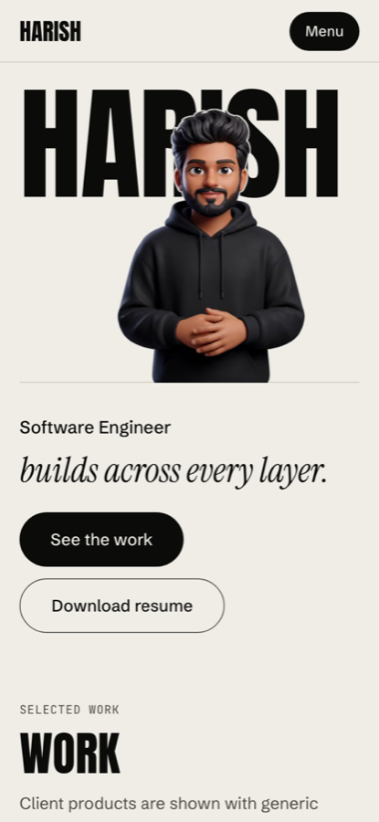

# harish-portfolio

Personal portfolio of **Harish Doraiswamy**, software engineer across mobile, web and backend (React Native, React, TypeScript, Node.js, SQL).

**Live:** https://harish-portfolio-harishlds-projects.vercel.app



## What's on the site

- **Name Wall hero**: name, role and CTAs readable with zero JS; the phone loops a CSS-only booking demo built from recreated UI.
- **Work**: a bento grid with layer filters (Mobile / Web / Backend). Every metric says whether it is platform reach or my own work; client products use generic names and recreated screens. Case studies open as an overlay or as their own page.
- **Layers**: a pinned section where one device turns from phone to browser to server rack while the chapters change beside it (swipe cards on phones, static steps under reduced motion).
- **Path, How I Work, Contact**: timeline, practices, and a contact section where the signal line lands in the CTA.

| Work                                    | Layers                                                  | Case study                                              | Mobile                                      |
| --------------------------------------- | ------------------------------------------------------- | ------------------------------------------------------- | ------------------------------------------- |
|  |  |  |  |

Quality bar, enforced in CI: Lighthouse on every page (desktop and mobile), axe on every page and the case-study overlay, a keyboard-only walkthrough, a 50 KB budget for our own initial JS, and content checks against the resume (`docs/content-audit.md`).

Built with Next.js (App Router), React and TypeScript. Statically generated, deployed on Vercel.

## Stack

| Concern    | Choice                                                | Why                                                               |
| ---------- | ----------------------------------------------------- | ----------------------------------------------------------------- |
| Framework  | Next.js 16 (App Router, Turbopack), React 19          | Static generation for SEO and speed, server components by default |
| Language   | TypeScript (strict, `noUncheckedIndexedAccess`)       | Catches content and prop mistakes at build time                   |
| Styling    | Tailwind CSS v4, tokens in `src/app/globals.css`      | One source of truth for the design spec                           |
| Fonts      | Self-hosted via `next/font/local` (OFL, Latin subset) | No font CDN at build or runtime, zero layout shift                |
| Animation  | GSAP + Flip + ScrollTrigger, all lazy-loaded          | One animation system for scroll, timelines and layout transitions |
| Unit tests | Vitest + React Testing Library                        | Fast component and logic tests                                    |
| E2E / a11y | Playwright + axe-core, desktop and mobile             | Real-browser checks, WCAG 2.1 AA scan on every page               |
| Perf       | Lighthouse CI budget in GitHub Actions                | Fails the PR if performance, a11y or CLS regress                  |

Deliberately not used: a second animation library (Motion), smooth-scroll hijacking (native scroll stays), WebGL/Three.js, CSS-in-JS.

## Getting started

Requires Node 22.12+ (see `.nvmrc`).

```bash
git clone https://github.com/HarishLD/harish-portfolio.git
cd harish-portfolio
npm ci
cp .env.example .env.local   # optional locally; defaults to http://localhost:3000
npm run dev                  # http://localhost:3000
```

## Scripts

| Script                | What it does                                                   |
| --------------------- | -------------------------------------------------------------- |
| `npm run dev`         | Dev server with hot reload                                     |
| `npm run build`       | Production build                                               |
| `npm run start`       | Serve the production build                                     |
| `npm run lint`        | ESLint, zero warnings allowed                                  |
| `npm run typecheck`   | Generate route types, then `tsc --noEmit`                      |
| `npm run format`      | Prettier (with Tailwind class sorting)                         |
| `npm test`            | Unit tests once (`npm run test:watch` to watch)                |
| `npm run e2e:install` | One-time: download Playwright's Chromium                       |
| `npm run e2e`         | E2E + accessibility against the production build (build first) |
| `npm run budget`      | Initial JS budget per page (after a build): framework + 50 KB  |
| `npm run check`       | Everything CI runs except E2E and Lighthouse                   |

Already have Chrome installed? Skip `e2e:install` and run `PLAYWRIGHT_CHROMIUM_PATH=/path/to/chrome npm run e2e`.

## Environment variables

Only public, non-secret values. Copy `.env.example` to `.env.local`; `.env*` files are git-ignored except the example.

| Variable               | Where                    | Notes                                                       |
| ---------------------- | ------------------------ | ----------------------------------------------------------- |
| `NEXT_PUBLIC_SITE_URL` | Local, Vercel Production | Canonical URL. Leave unset on previews (Vercel URL is used) |

If a secret is ever needed (contact form, analytics key), it goes in Vercel's Environment Variables UI only, never in the repo.

## Project structure

```
src/
  app/            routes, root layout, fonts, global tokens
    work/[slug]/          full case study pages (static)
    @modal/(.)work/[slug]/ the same case study as an overlay over the home page
  lib/            framework-free helpers (site config, cx)
  fonts/          vendored woff2 + licenses
  components/
    ui/           primitives: Container, Section, Card, Button(Link), Label, Display, Accent, SignalDot
    motion/       lazy GSAP loaders, useLazyGsap, MotionProvider (reduced motion)
    nav/          desktop bar → dock (GSAP Flip), mobile full-screen <dialog> menu
    hero/         Name Wall, fake-3D device, scroll morph island
    signal/       signal thread segments + draw-in island
    work/         bento grid, layer filters (island), cards
    case-study/   case study body + overlay shell
    screens/      recreated client screens (HTML/CSS, labelled, sample data)
    layers/       Layers: chapters, inline simple-icons marks, pinned morph island
    path/, how/   Path timeline and How I Work
    contact/      Contact (signal lands in the CTA), copy-email island
  content/        typed resume-backed content, validated with zod at build time
e2e/              Playwright specs
.github/          CI workflow, Dependabot
```

## Workflow

- `main` is production. Every change lands through a pull request.
- One branch per milestone (`m1-foundations`, `m2-hero`, ...). Each PR gets a Vercel preview URL and must pass CI.
- Content claims come from the resume only. Metrics must declare whether they are platform-wide or personal; recreated client screens must be labelled.

## Milestones

- [x] M0 Setup: tooling, CI, deploy pipeline
- [x] M1 Foundations: tokens, primitives, content layer, navigation, motion provider
- [x] M2 Hero: Name Wall, morphing device, signal
- [x] M3 Work: bento grid, filters, case studies
- [x] M4 Layers, Path, How I Work
- [x] M5 Contact, resume, SEO (indexing switched on here)
- [x] M6 QA and polish: Lighthouse every page, axe and keyboard, 404, favicons, content audit

## License

Code: all rights reserved. Fonts: SIL Open Font License, see `src/fonts/licenses`.
